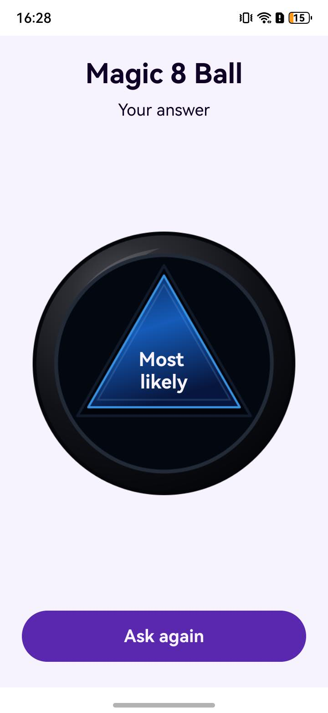

# Magic 8 Ball

Magic 8 Ball is an OpenHarmony app for default and tablet devices that draws a random answer to a yes or no question.

## What this example demonstrates

| Capability | API or platform service | Where to look |
| --- | --- | --- |
| Reveal a randomly selected answer by tapping the ball or **Ask again** | `Math.random()` and ArkUI `onClick` | [Answer selection](entry/src/main/ets/entryability/Magic8Ball.ets), [page](entry/src/main/ets/pages/Index.ets) |
| Update the displayed answer after a tap | ArkUI `@State`, `Text`, and resource references | [Page](entry/src/main/ets/pages/Index.ets), [English strings](entry/src/main/resources/en_US/element/string.json), [Chinese strings](entry/src/main/resources/zh_CN/element/string.json) |

## Preview



## Requirements

Use Node.js 20 or later, Java 17, OpenHarmony command-line tools, and the OpenHarmony 6.1 SDK (API 23). The app compiles and targets API 23 while retaining API 20 as its minimum. Generate development signing for `com.example.magic8ball` locally.

The [module manifest](entry/src/main/module.json5) lists default and tablet devices. It declares no permissions, and the app uses no external service.

## Build and run

From the repository root, run:

```sh
npm install --global @oniroproject/oniro-app@0.10.0
oniro-app sdk install 6.1
oniro-app cmdtools install
cp build-profile.example.json5 build-profile.json5
oniro-app sign
oniro-app build
```

The signed HAP is at `entry/build/default/outputs/default/entry-default-signed.hap`. Install it on an OpenHarmony device with a compatible API level. Local signing files and `build-profile.json5` are ignored by Git. Use separate credentials for distribution.

## Use

Think of a yes or no question and tap the ball. Tap the ball again or press **Ask again** to draw another answer. The page selects from 20 answers and displays them in English or Chinese according to the device's resource locale.

## Explore the implementation

[EntryAbility](entry/src/main/ets/entryability/EntryAbility.ets) loads `pages/Index`. The [page](entry/src/main/ets/pages/Index.ets) passes 20 localized string resources to `Magic8Ball<ResourceStr>`. Its ball and button handlers call `drawAnAnswer()` in the [answer selection class](entry/src/main/ets/entryability/Magic8Ball.ets), store the selected resource in `@State`, and display it with `Text(this.answer)`. The [base](entry/src/main/resources/base/element/string.json), [English](entry/src/main/resources/en_US/element/string.json), and [Chinese](entry/src/main/resources/zh_CN/element/string.json) resource files contain the answer text. Editable artwork for the ball and app icon is in [assets/brand](assets/brand/).

When `answer` changes, ArkUI updates components that depend on it.

## Verify

On a device, check that the initial ball shows the 8, tapping it shows an answer, and tapping the ball or **Ask again** draws again. Change the device language between English and Chinese to check the localized labels and answers.

## Contributing

These apps are focused examples of specific platform capabilities. Contributions that keep an example correct, buildable, and clear are welcome, including bug fixes, documentation and setup corrections, and improvements to its existing behavior. Please keep pull requests within the app's stated purpose and describe how you verified the change.

**Found a problem but can't fix it?** Open an issue in this repository; a pull request is not required. For a bug or broken build, include the steps to reproduce it, what you expected, what happened, and your device, OS, and SDK/API version. Logs or screenshots are helpful when available. You can also open an issue for inaccurate or unclear documentation.

## License

This project is licensed under the Apache License, Version 2.0. See [LICENSE](LICENSE).
